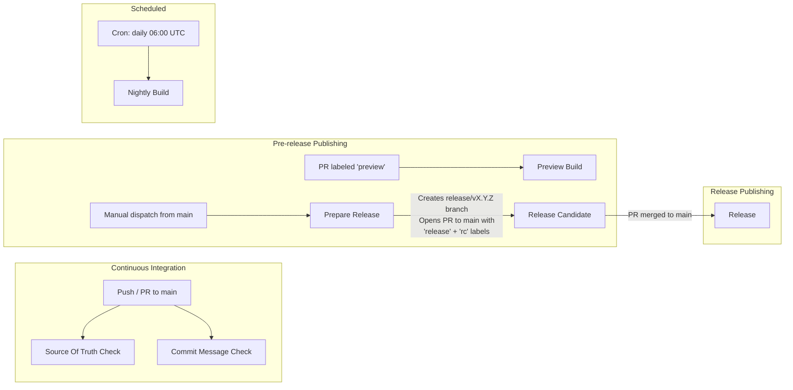
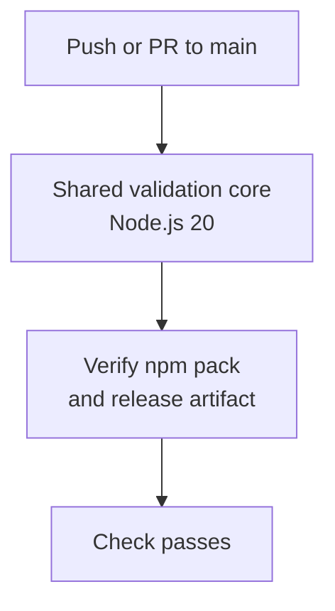
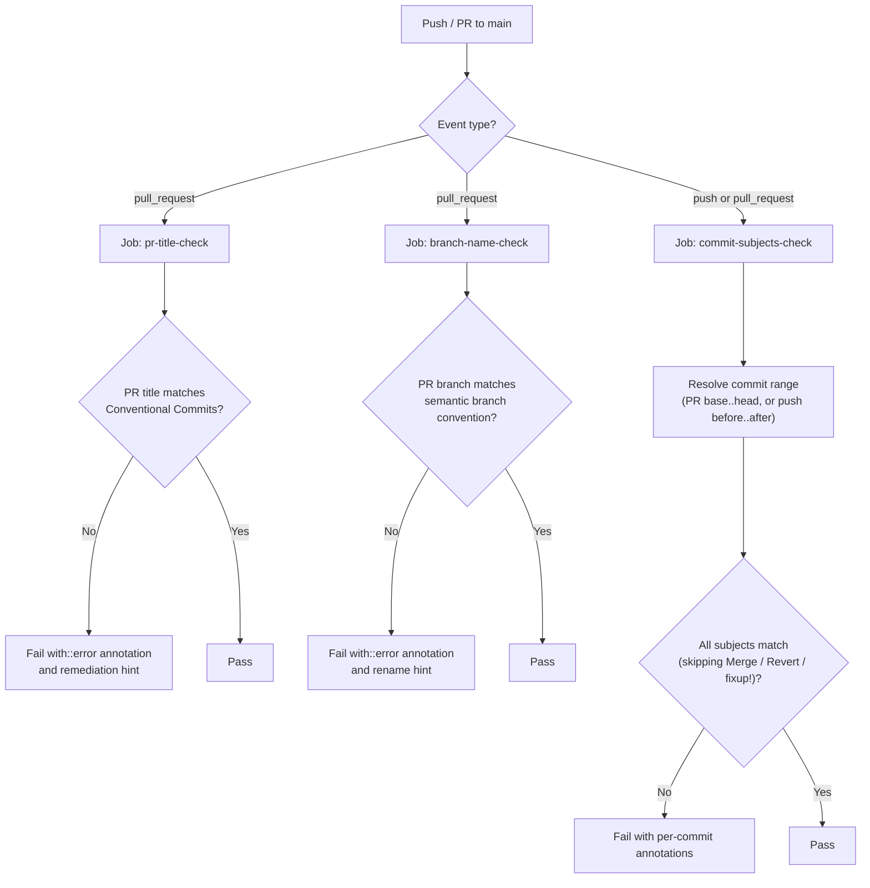
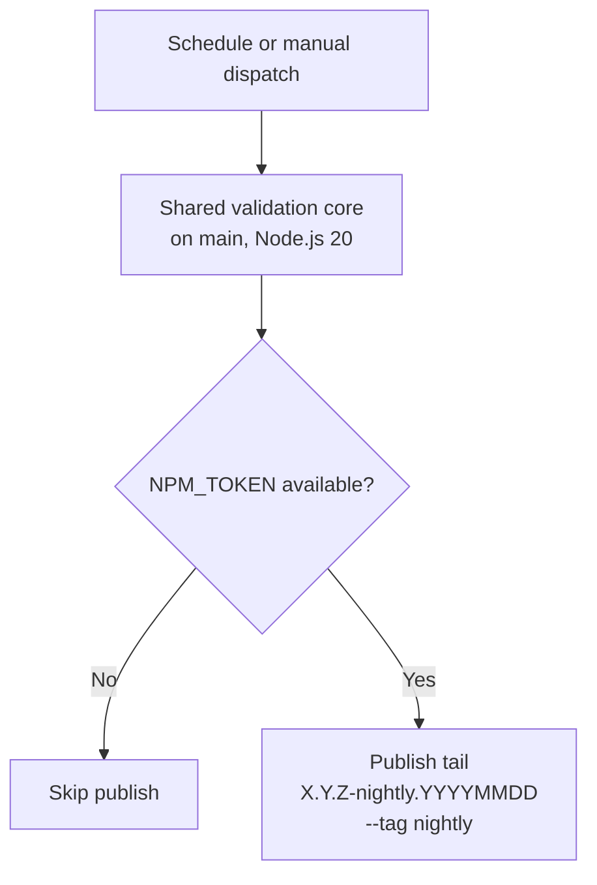
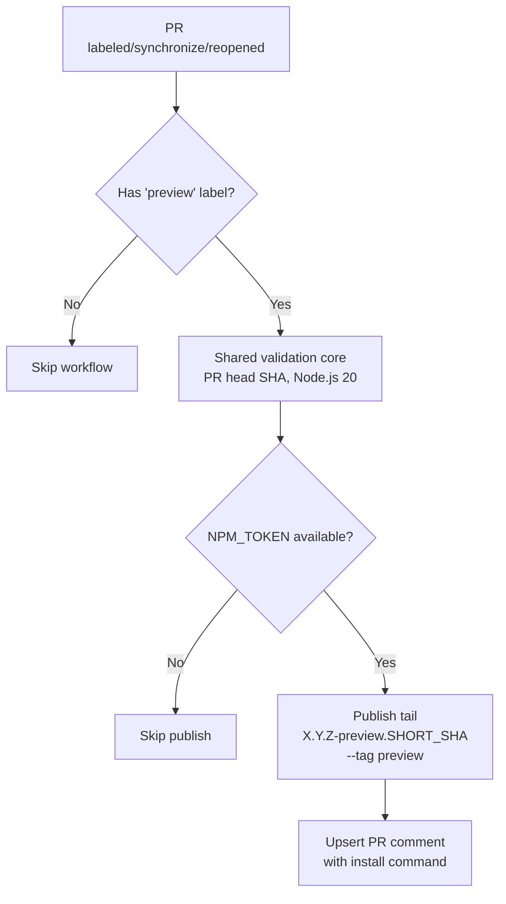
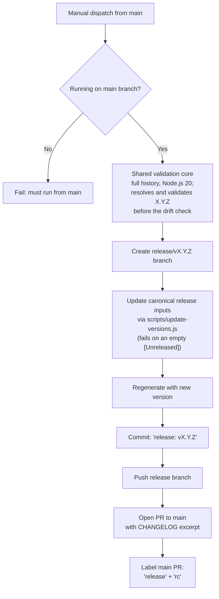
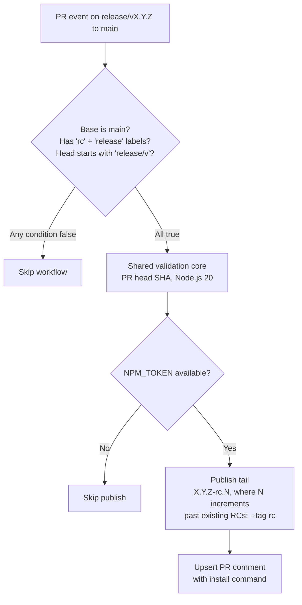
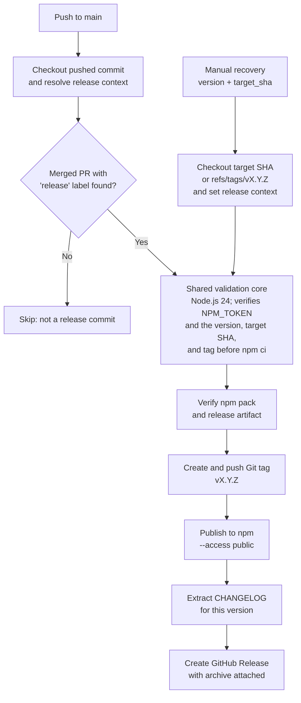
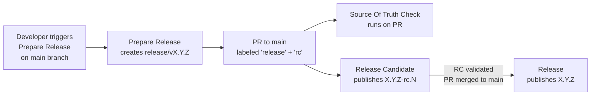
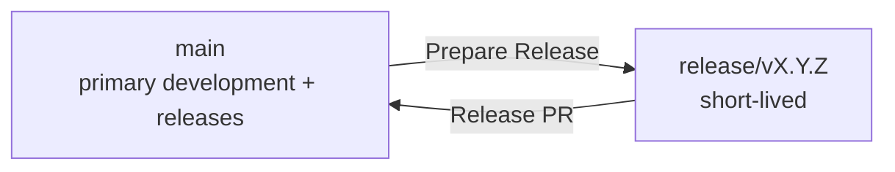

<!-- Source: .github/workflows/*.yml, justfile -->

# CI/CD Pipeline

Maestro uses seven GitHub Actions workflows. Six are organized around a **source-of-truth enforcement** model — each verifies that the generated runtime adapters match canonical `src/` before proceeding. The seventh, **Commit Message Check**, validates semantic git conventions for PR branch names, PR titles, and commit subjects targeting `main`. Together they span continuous integration on every push/PR through automated release publishing to npm.

## Workflow Overview



The six source-of-truth workflows share the validation core below, and the three prerelease workflows share the publish tail. Each workflow section lists only what it adds or changes. Source Of Truth Check and stable Release also verify npm package contents and the self-contained release archive. Source Of Truth Check additionally runs focused state concurrency, recovery, CLI, and hook tests on Linux, macOS, and Windows with Node 20 and 24. Commit Message Check is independent: it does not regenerate or test, it only validates branch naming, PR-title formatting, and commit-subject formatting.

### Shared Validation Core

The main job of every source-of-truth workflow runs these steps in this order. A workflow's own steps may run between them, as its section notes, and any failure stops the job.

| Step | Description |
|------|-------------|
| Checkout | Pins `actions/checkout` to SHA `11bd71901bbe5b1630ceea73d27597364c9af683` (v4.2.2) |
| Setup Node.js | Pins `actions/setup-node` to SHA `49933ea5288caeca8642d1e84afbd3f7d6820020` (v4.4.0); Node.js 20 unless the workflow section says otherwise |
| Install build dependencies | Runs `npm ci`; parser dependencies are needed for generation and graph checks |
| Check adapter drift | Runs `node scripts/generate.js --check`, which writes nothing, lists each generated file that would be created, updated, or removed, and exits 1 if there are any |
| Run full test suite | Runs `npm test` (the `node --test` globs over `tests/unit/`, `tests/transforms/`, and `tests/integration/` in `package.json`), which includes the layer-boundary check |

### Shared Publish Tail

Nightly Build, Preview Build, and Release Candidate publish a prerelease after the core:

| Step | Description |
|------|-------------|
| Set version | Computes the workflow's prerelease version and applies it with `npm version --no-git-tag-version` |
| Regenerate runtime metadata | Runs `node scripts/generate.js` so runtime manifests and MCP package specs use the prerelease version |
| Verify npm package contents | Runs `npm run pack:verify` against the prerelease package surface |
| Publish | Publishes through `node scripts/npm-publish-idempotent.js --tag <dist-tag> --access public` with `NODE_AUTH_TOKEN` derived from `NPM_TOKEN`, skipping if the exact version already exists |

In these three workflows, every step after **Run full test suite** is gated on `if: env.NPM_TOKEN != ''` (the job-level `NPM_TOKEN` env holds the secret), so publishing is skipped when the secret is absent. Stable Release instead requires `NPM_TOKEN` and publishes the committed version without the set-version and regenerate steps.

## Source Of Truth Check

### Purpose

The foundational CI gate. Enforces that all generated runtime adapters (Antigravity, Claude Code, Codex, and Qwen Code) are in sync with canonical source in `src/`, and that the full test suite passes. Runs on every push and pull request targeting `main`.

### Trigger

| Event | Branches |
|-------|----------|
| `push` | `main` |
| `pull_request` | `main` |

### Flow



### Job Breakdown

**Job: `check-architecture` (name: `source-of-truth-check`)** runs the [shared validation core](#shared-validation-core) unchanged, then:

| Step | Description |
|------|-------------|
| Verify npm package contents | Runs `npm run pack:verify` to ensure npm dry-run packaging contains required runtime files and no test-only directories |
| Package release artifact | Runs `npm run release:artifacts` to build the generic GitHub Release archive |
| Verify release artifact | Runs `npm run release:verify-artifacts` to validate that archive |

**Job: `state-portability`** runs six combinations of `ubuntu-latest`, `macos-latest`, and `windows-latest` with Node 20 and 24. It installs locked dependencies and exercises ownership contention, process termination at journal boundaries, roll-forward recovery, simultaneous MCP mutations, guarded CLI writes, and retained session/hook behavior. Matrix failures do not cancel the other platforms.

### Environment and Secrets

`permissions: contents: read` (least privilege; only needs to read the repository). No secrets or environment variables required.

### Artifacts

Creates an ignored local `dist/release/maestro-vX.Y.Z-extension.tar.gz` during validation, but does not upload it from PR CI.

The extension archive contains runtime code and content, excluding generator sources, entry-point templates, stub transforms, and their build-only helpers. Packaging and verification enforce this archive boundary independently. The npm package omits them and the build and release scripts too, keeping only the Codex installer and the `src/platforms/metadata.js` and Qwen policy-pack modules it loads; `generate`, `build`, and `prepack` run from a repository checkout.

### Key Behaviors

- On drift, `generate.js --check` lists each pending `[CREATE]`, `[UPDATE]`, or `[REMOVE]` path, so the log shows which files are out of sync, including outputs that were never committed.
- This workflow serves as the required status check that blocks PR merges.

---

## Commit Message Check

### Purpose

Enforces semantic git conventions for work targeting `main`: PR branch names must use the repo's semantic branch format, PR titles must follow [Conventional Commits](https://www.conventionalcommits.org/en/v1.0.0/), and every commit subject in the PR range must be conventional. This closes the local-hook bypass (`git commit --no-verify`) by re-validating in CI. The workflow also runs on direct pushes to `main` to cover admin overrides and emergency hotfixes that bypass the PR flow.

### Trigger

| Event | Branches | Types |
|-------|----------|-------|
| `pull_request` | `main` | `opened`, `edited`, `reopened`, `synchronize` |
| `push` | `main` | — |

### Flow



### Job Breakdown

**Job: `check-pr-title` (name: `pr-title-check`)** — runs only on `pull_request` events.

| Step | Description |
|------|-------------|
| Checkout | Pins `actions/checkout` to SHA `11bd71901bbe5b1630ceea73d27597364c9af683` (v4.2.2) so the job can source `.githooks/lib/semantic-git.sh` |
| Validate PR title | Reads `github.event.pull_request.title` via the `PR_TITLE` env var; tests it against `SEMANTIC_COMMIT_PATTERN` from `semantic-git.sh`; emits `::error::` annotation with format guidance on failure |

**Job: `check-pr-branch` (name: `branch-name-check`)** — runs only on `pull_request` events.

| Step | Description |
|------|-------------|
| Checkout | Pins `actions/checkout` to SHA `11bd71901bbe5b1630ceea73d27597364c9af683` (v4.2.2) so the job can source `.githooks/lib/semantic-git.sh` |
| Validate PR branch | Reads `github.event.pull_request.head.ref` and checks it with `semantic_branch_name_is_valid`, which accepts `<type>/<slug>`, `<namespace>/<type>/<slug>`, `release/vX.Y.Z`, protected branch names, and known automation prefixes; emits `::error::` annotation with rename guidance on failure |

**Job: `check-commits` (name: `commit-subjects-check`)** — runs on both event types.

| Step | Description |
|------|-------------|
| Checkout | Pins `actions/checkout` to SHA `11bd71901bbe5b1630ceea73d27597364c9af683` (v4.2.2) with `fetch-depth: 0` to access the full history |
| Validate commit subjects | Resolves the commit range from the event (PR: `base.sha..head.sha`; push: `before..after`, or `after~1..after` on initial push); iterates `git log --format='%H %s'`; checks each subject with `semantic_commit_subject_is_valid`, which passes through `Merge`, `Revert`, `fixup!`, `squash!`, and `amend!` subjects |

### Environment and Secrets

`permissions: contents: read` (least privilege; only needs to read the repository). No secrets required. Safe for fork PRs.

### Artifacts

None produced or consumed.

### Key Behaviors

- All three jobs source `.githooks/lib/semantic-git.sh`, the same library the local `commit-msg`, `pre-commit`, and `pre-push` hooks source, so local-pass and CI-pass agree. Branch names are checked locally before committing, locally before pushing, and in CI before merging.
- The PR-title job tests `SEMANTIC_COMMIT_PATTERN` directly, so it has no pass-throughs. The commit-subjects job uses `semantic_commit_subject_is_valid`, which accepts the git-generated `Merge `, `Revert `, `fixup!`, `squash!`, and `amend!` subjects (interactive rebases, merges, reverts) exactly as the `commit-msg` and `pre-push` hooks do.
- Bot-authored release commits (`release: vX.Y.Z` from Prepare Release) match the regex without exception.
- The `push` trigger means even a direct admin push to `main` is validated post-hoc — failures appear as red checks on the commit on `main`.

---

## Nightly Build

### Purpose

Publishes a nightly snapshot of the `main` branch to npm under the `nightly` dist-tag. Validates the `main` branch has no drift and passes all tests before publishing. Runs on a daily schedule and can be triggered manually.

### Trigger

| Event | Details |
|-------|---------|
| `schedule` | Cron: `0 6 * * *` (daily at 06:00 UTC) |
| `workflow_dispatch` | Manual trigger with no inputs |

### Flow



### Job Breakdown

**Job: `nightly`** runs the [shared validation core](#shared-validation-core) and the [publish tail](#shared-publish-tail) with these differences:

| Step | Description |
|------|-------------|
| Checkout | Checks out `refs/heads/main` explicitly |
| Setup Node.js | Sets `registry-url` to `https://registry.npmjs.org` |
| Set nightly version | Computes the version as `{base}-nightly.{YYYYMMDD}` |
| Publish nightly | Publishes with `--tag nightly` |

### Environment and Secrets

| Item | Type | Purpose |
|------|------|---------|
| `NPM_TOKEN` | Secret | Authenticates with npm registry for publishing |
| `NODE_AUTH_TOKEN` | Env (derived) | Set to `$NPM_TOKEN` value for npm CLI authentication |

**Permissions**: `contents: read`

### Artifacts

Publishes `@josstei/maestro@X.Y.Z-nightly.YYYYMMDD` to npm with the `nightly` dist-tag.

### Key Behaviors

- Always checks out the `main` branch regardless of what triggered it.
- The version string includes the date stamp, so each nightly replaces the previous day's version on the `nightly` tag.
- When `NPM_TOKEN` is absent, the workflow still validates drift and runs tests, providing health checks for forks.

---

## Preview Build

### Purpose

Publishes a preview package from a pull request so reviewers can install and test changes before merging. Activated by adding the `preview` label to any PR.

### Trigger

| Event | Details |
|-------|---------|
| `pull_request` | Types: `labeled`, `synchronize`, `reopened` |
| **Condition** | PR must have the `preview` label |

### Flow



### Job Breakdown

**Job: `preview`** runs the [shared validation core](#shared-validation-core) and the [publish tail](#shared-publish-tail) with these differences:

| Step | Description |
|------|-------------|
| Checkout | Checks out the PR head repository and SHA (supports fork PRs) |
| Setup Node.js | Sets the npm registry URL |
| Set preview version | Computes the version as `{base}-preview.{7-char SHA}` |
| Publish preview | Publishes with `--tag preview` |
| Upsert PR comment | Posts or updates a PR comment with the install command, reading the package name from `package.json` |

### Environment and Secrets

| Item | Type | Purpose |
|------|------|---------|
| `NPM_TOKEN` | Secret | npm registry authentication |
| `NODE_AUTH_TOKEN` | Env (derived) | Set to `$NPM_TOKEN` for npm CLI |
| `GH_TOKEN` | Env (derived) | Set to `${{ github.token }}` for PR comment API calls |

**Permissions**: `contents: read`, `pull-requests: write`

### Artifacts

Publishes `@josstei/maestro@X.Y.Z-preview.SHORT_SHA` to npm with the `preview` dist-tag.

### Key Behaviors

- Uses concurrency group `preview-{PR number}` with `cancel-in-progress: true`, so pushing new commits cancels any in-flight preview build for the same PR.
- The PR comment is **upserted**: if a comment starting with "Preview published:" already exists, it is updated in place rather than posting a duplicate.
- The version embeds the first 7 characters of the commit SHA, making each preview uniquely traceable to a specific commit.

---

## Prepare Release

### Purpose

Orchestrates the release preparation process. Creates a release branch from `main`, bumps version numbers, and opens a pull request targeting `main` (the actual release PR). This is the entry point for the release pipeline.

### Trigger

| Event | Details |
|-------|---------|
| `workflow_dispatch` | Manual trigger from the `main` branch only |
| **Input** | `version` (optional string): explicit version to release; when omitted, the version is inferred from commit history |

### Flow



### Job Breakdown

**Job: `prepare`** runs the [shared validation core](#shared-validation-core) with these differences and additions:

| Step | Description |
|------|-------------|
| Validate branch | Runs before checkout; fails if not running from `refs/heads/main` |
| Checkout | Full history (`fetch-depth: 0`) using `RELEASE_TOKEN` for push permissions |
| Resolve and validate target version | Runs between **Install build dependencies** and **Check adapter drift**. Uses the explicit `version` input if provided; otherwise scans commit logs since the last tag and infers the bump level (`BREAKING CHANGE` or `!:` triggers major, `feat` triggers minor, otherwise patch). Fails unless the result matches the `X.Y.Z` semver pattern, then exports it as `VERSION` for the later steps |
| Create release branch | Creates `release/vX.Y.Z` from current `main` |
| Update canonical release inputs | Runs `node scripts/update-versions.js` with the target version to update `package.json`, README badges, and CHANGELOG; fails if the `[Unreleased]` section in `CHANGELOG.md` has no content |
| Regenerate with new version | Reruns generator to derive runtime metadata from `package.json`, then runs `npm install --package-lock-only` to update lockfile |
| Commit release | Commits all changes as `release: vX.Y.Z` using the `github-actions[bot]` identity |
| Push release branch | Pushes `release/vX.Y.Z` to origin |
| Open release PR to main | Creates a PR merging `release/vX.Y.Z` into `main` with CHANGELOG excerpt as body |
| Label release PR | Adds `release` and `rc` labels to the main-targeting PR |

### Environment and Secrets

| Item | Type | Purpose |
|------|------|---------|
| `RELEASE_TOKEN` | Secret | Personal access token with write permissions; used for checkout, branch push, PR creation, and PR labeling. Required because the default `GITHUB_TOKEN` cannot trigger downstream workflows. |

**Permissions**: `contents: write`, `pull-requests: write`

### Artifacts

Creates the `release/vX.Y.Z` branch and a pull request targeting `main` with the CHANGELOG excerpt.

### Key Behaviors

- The version inference algorithm uses conventional commit patterns: `BREAKING CHANGE` or `!:` in commit messages triggers a major bump, `feat` commits trigger minor, everything else triggers patch.
- `scripts/update-versions.js` refuses an empty `[Unreleased]` section, so no release ships without documented changes.
- The `release` and `rc` labels on the main-targeting PR are what trigger the Release Candidate workflow.
- Uses `RELEASE_TOKEN` (not the default `GITHUB_TOKEN`) so that the push and PR creation events trigger downstream workflow runs (Source Of Truth Check on the new PR, and Release Candidate when labels are applied).

---

## Release Candidate

### Purpose

Publishes release candidate packages to npm from release PRs targeting `main`. Activates automatically when the Prepare Release workflow labels a PR with both `release` and `rc`. Provides an installable RC package for final validation before the release merges.

### Trigger

| Event | Details |
|-------|---------|
| `pull_request` | Types: `labeled`, `synchronize`, `reopened` |
| **Conditions (all must be true)** | Base branch is `main` |
| | PR has both `rc` and `release` labels |
| | Head branch starts with `release/v` |

### Flow



### Job Breakdown

**Job: `rc`** runs the [shared validation core](#shared-validation-core) and the [publish tail](#shared-publish-tail) with these differences:

| Step | Description |
|------|-------------|
| Checkout | Checks out the PR head repository and SHA |
| Setup Node.js | Sets the npm registry URL |
| Determine RC version | Reads the base version and package name from `package.json`, queries the npm registry for existing RC versions of this base, and increments the RC number to avoid collisions |
| Publish RC | Publishes with `--tag rc` |
| Upsert PR comment | Posts or updates a comment with the install command and short SHA |

### Environment and Secrets

| Item | Type | Purpose |
|------|------|---------|
| `NPM_TOKEN` | Secret | npm registry authentication |
| `NODE_AUTH_TOKEN` | Env (derived) | Set to `$NPM_TOKEN` for npm CLI |
| `GH_TOKEN` | Env (derived) | Set to `${{ github.token }}` for PR comment API calls |

**Permissions**: `contents: read`, `pull-requests: write`

### Artifacts

Publishes `@josstei/maestro@X.Y.Z-rc.N` to npm with the `rc` dist-tag, where `N` is auto-incremented.

### Key Behaviors

- Uses concurrency group `rc-{PR number}` with `cancel-in-progress: true` to avoid duplicate RC publishes when new commits are pushed to the release branch.
- The RC number auto-increments by querying `npm view` for existing versions, ensuring no version collision even when the workflow runs multiple times for the same base version.
- The PR comment is upserted (update existing or create new) to keep a single, current RC reference on the PR.

---

## Release

### Purpose

The final step of the release pipeline. Triggers on any push to `main`, but only acts when the push is a merged pull request carrying the `release` label. It can also be manually dispatched to recover a failed post-tag stable publish. Validates package and archive contents, creates or reuses the matching Git tag, publishes the stable package to npm, then publishes a GitHub Release with CHANGELOG notes and the self-contained extension archive attached.

### Trigger

| Event | Details |
|-------|---------|
| `push` | Branch: `main` |
| `workflow_dispatch` | Manual stable recovery with `version` and optional `target_sha`; when `target_sha` is omitted, the workflow checks out `refs/tags/v<version>` |
| **Condition** | The pushed commit must be the merge commit of a PR labeled `release` that targeted `main` |

### Flow



### Job Breakdown

**Job: `release`** runs the [shared validation core](#shared-validation-core) with these differences and additions:

| Step | Description |
|------|-------------|
| Checkout push commit, Checkout recovery target | Conditional on the event, both with full history (`fetch-depth: 0`) for tag operations. Push releases check out the pushed commit; manual recovery checks out `target_sha` or `refs/tags/v<version>`. |
| Resolve release context | Push releases query the GitHub API for PRs associated with the current commit SHA and filter for merged PRs targeting `main` with the `release` label. Manual recovery sets the release context from the supplied version. If no push release is found, sets `is_release=false` and all subsequent steps are skipped. |
| Setup Node.js | Node.js 24 with npm registry URL |
| Verify npm token | Runs before **Install build dependencies**; fails before tag or publish work unless `NPM_TOKEN` is configured |
| Extract and validate version | Runs before **Install build dependencies**. Reads version from `package.json` and cross-validates: the version must be stable semver, the CHANGELOG must have a matching section (unconditional), any existing `vX.Y.Z` tag must point at the checked-out target SHA, and manual recovery must match both the requested `version` and `target_sha` when supplied. When the release branch name matches `release/vX.Y.Z` and the PR title matches `release: vX.Y.Z`, their embedded versions must agree with `package.json`. |
| Verify npm package contents | Runs `npm run pack:verify` before any tag or publish operation |
| Package release artifact | Runs `npm run release:artifacts` to create `dist/release/maestro-vX.Y.Z-extension.tar.gz` |
| Verify release artifact | Runs `npm run release:verify-artifacts` against the generated archive |
| Create and push tag | Creates Git tag `vX.Y.Z` at the checked-out target SHA; handles idempotency (skips if tag exists at same SHA, fails if tag exists at different SHA) |
| Publish to npm | Publishes stable release through `node scripts/npm-publish-idempotent.js --access public` with `NODE_AUTH_TOKEN` derived from `NPM_TOKEN`, skipping if the exact version already exists |
| Extract changelog for version | Extracts the version-specific section from `CHANGELOG.md` using `awk` |
| Create GitHub Release | Uses `softprops/action-gh-release` (pinned to SHA `c95fe1489396fe8a9eb87c0abf8aa5b2ef267fda`, v2.2.1) with CHANGELOG excerpt as body and the generic extension archive attached |

### Environment and Secrets

| Item | Type | Purpose |
|------|------|---------|
| `GH_TOKEN` | Env (derived) | Set to `${{ github.token }}` for the GitHub API lookup of the merged release PR |
| `NPM_TOKEN` | Secret | npm registry authentication for stable publish and dist-tag repair |
| `NODE_AUTH_TOKEN` | Env (derived) | Set to `$NPM_TOKEN` for npm CLI |

**Permissions**: `contents: write`, `pull-requests: write`

### Artifacts

- Git tag `vX.Y.Z` pushed to origin
- Stable npm package `@josstei/maestro@X.Y.Z` published with the `latest` dist-tag
- GitHub Release with CHANGELOG body and `maestro-vX.Y.Z-extension.tar.gz`

### Key Behaviors

- The release detection uses the GitHub API to find the PR associated with the merge commit, filtering for the `release` label. Non-release pushes to `main` exit early and cleanly.
- Manual recovery is only for stable versions and requires the checked-out commit, `package.json`, `CHANGELOG.md`, and existing `vX.Y.Z` tag to agree. This recovers failures after tag creation without creating a new version or publishing from a maintainer laptop.
- Version validation cross-checks `package.json` against the CHANGELOG (unconditional), the existing tag when present, and, when applicable, against the release branch name (`release/vX.Y.Z`) and the PR title (`release: vX.Y.Z`). A mismatch in any available source fails the workflow.
- Stable releases require `NPM_TOKEN`; npm Trusted Publishing should only replace it after the package owner explicitly configures and tests that path.
- npm `latest` is stable-only. The publish helper rejects prereleases published without an explicit prerelease tag or with `latest`, rejects stable publishes with prerelease dist-tags, moves a `latest` that points at a prerelease back to the highest stable version (or warns and defers that repair, never deleting `latest`, when no stable version exists), and moves `latest` to the stable version after a stable publish or idempotent skip.
- Tag creation is idempotent: if the tag already exists at the same commit, the step is skipped. If it exists at a different commit, the workflow fails to prevent overwriting a release.

---

## Build Commands

The `justfile` provides local development commands that mirror CI behavior. [CONTRIBUTING.md](https://github.com/josstei/maestro-orchestrate/blob/main/CONTRIBUTING.md#key-commands) lists each command with its CI equivalent.

### CI Mapping

The workflows run the commands behind these `just` recipes, except that they check drift with `node scripts/generate.js --check`:

```
just generate        -->  node scripts/generate.js
just check           -->  node scripts/generate.js && git diff --exit-code --name-only
just test            -->  npm test
just pack-verify     -->  npm run pack:verify
just release-verify  -->  npm run release:artifacts && npm run release:verify-artifacts
```

`just ci` runs `check`, `test`, `pack-verify`, and `release-verify`, matching the `source-of-truth-check` job after `npm ci`.

---

## Workflow Relationships

### Release Pipeline Chain

The release pipeline is a multi-workflow chain where each stage triggers the next through Git events and PR labels.



### Step-by-Step Release Flow

1. A maintainer manually triggers **Prepare Release** from the `main` branch (optionally specifying a version).
2. The workflow validates `main` (drift check and tests), creates a `release/vX.Y.Z` branch, bumps version files (failing if the CHANGELOG has no unreleased content), and pushes the branch.
3. One PR is opened:
   - **PR to `main`**: the release PR, labeled with `release` and `rc`, containing the CHANGELOG excerpt.
4. The release PR triggers **Source Of Truth Check** (standard CI on PRs to `main`).
5. The `release` + `rc` labels on a PR from `release/v*` to `main` trigger the **Release Candidate** workflow, which publishes an RC to npm.
6. If additional commits are pushed to the release branch, both Source Of Truth Check and Release Candidate re-run (RC number auto-increments).
7. When the release PR is merged to `main`, the push event triggers **Release**.
8. Release detects the merged release PR via the GitHub API, validates version consistency, runs final checks, creates a Git tag, publishes to npm, and creates a GitHub Release with the generic extension archive attached.

### Branch Strategy



| Branch | Purpose | Protected |
|--------|---------|-----------|
| `main` | Primary development and release branch; all feature work and releases merge here | Yes (CI required) |
| `<type>/<slug>` | Contributor work branches using the same type vocabulary as Conventional Commits | PR check required |
| `<namespace>/<type>/<slug>` | Namespaced contributor/tool work branches, such as `codex/chore/enforce-git-conventions` | PR check required |
| `release/vX.Y.Z` | Short-lived release branches created by Prepare Release | Transient |

### Permissions and Secrets Summary

| Workflow | Permissions | Secrets |
|----------|-------------|---------|
| Source Of Truth Check | `contents: read` | None |
| Commit Message Check | `contents: read` | None |
| Nightly Build | `contents: read` | `NPM_TOKEN` |
| Preview Build | `contents: read`, `pull-requests: write` | `NPM_TOKEN` |
| Prepare Release | `contents: write`, `pull-requests: write` | `RELEASE_TOKEN` |
| Release Candidate | `contents: read`, `pull-requests: write` | `NPM_TOKEN` |
| Release | `contents: write`, `pull-requests: write` | `NPM_TOKEN` |

The `RELEASE_TOKEN` used by Prepare Release is a personal access token with elevated permissions. The default `GITHUB_TOKEN` does not trigger downstream workflow runs, so `RELEASE_TOKEN` is required for branch pushes and PR creation that need to activate Source Of Truth Check and Release Candidate on the newly created PR.

### npm Dist-Tags

| Tag | Source | Version Pattern | Workflow |
|-----|--------|-----------------|----------|
| `latest` | Stable release from `main` | `X.Y.Z` | Release |
| `rc` | Release candidate from release PR | `X.Y.Z-rc.N` | Release Candidate |
| `preview` | PR preview build | `X.Y.Z-preview.SHORT_SHA` | Preview Build |
| `nightly` | Daily main snapshot | `X.Y.Z-nightly.YYYYMMDD` | Nightly Build |

`latest` must never intentionally point at `rc`, `preview`, or `nightly`. If a prerelease publish or idempotent skip sees `latest` pointing to a prerelease and at least one stable version exists, the helper repairs it by moving `latest` back to the highest published stable version. If no stable version exists yet, the helper logs a warning and defers repair until the stable Release workflow publishes `X.Y.Z`; it does not delete `latest`.
